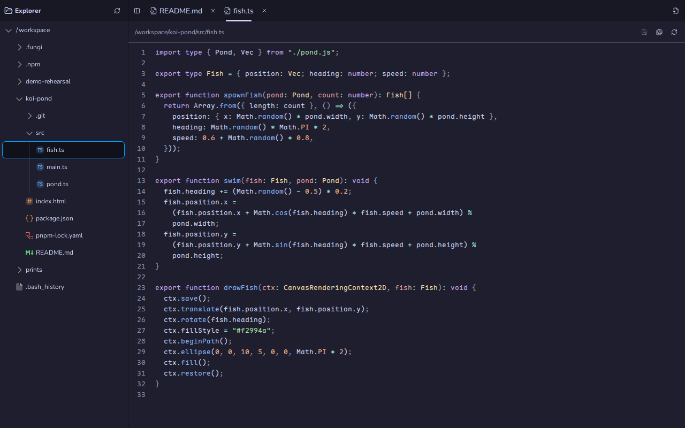
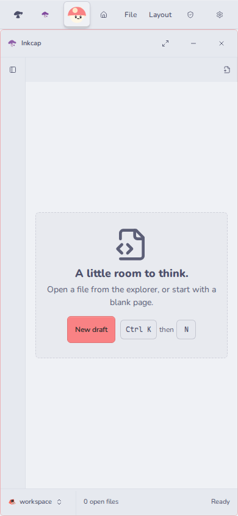

# Inkcap (`@fungi.computer/inkcap`)

Inkcap edits the files on your Computer: a file explorer, tabs and a code editor
in the browser.



Inkcap is one of the starter Apps of
[Oyster](https://github.com/fungi-computer/oyster), the open App host that runs
on your own Cloudflare account. On Oyster, the Computer is a Linux workspace in
a Cloudflare Container, and Inkcap reads and writes its `/workspace`.

## What you can do

- Browse the Computer's folders and open files in tabs.
- Edit text with syntax highlighting, and save with **Ctrl+S** / **⌘S**.
- Preview images (PNG, JPEG, GIF, WebP, SVG and AVIF) and video (MP4 and WebM).
- Turn on **Preview Markdown** for any `.md` file.
- Create files and folders, **Save file as** another path, or download a draft
  without writing it.
- Resolve conflicts: when a file changed on the Computer after you opened it,
  choose **Keep mine**, **Reload theirs** or **Compare** before anything is
  overwritten.

Closing a tab or the App with unsaved edits asks whether to save, discard or
cancel. On a phone, **Open file explorer** brings the explorer over the editor.



## Get it

Inkcap installs with the other starter Apps. On a deployed Oyster (see the
[Oyster quick start](https://github.com/fungi-computer/oyster#quick-start-deploy-your-own-oyster)),
run:

```sh
export OYSTER_URL=https://oyster.<your-subdomain>.workers.dev
export OYSTER_OWNER_KEY=<your owner key>
npx oyster install-apps
```

The installer clones this repository and the six others, seeds each on your
Oyster with `git push`, builds them on your Computer and installs them. Sign in
at `$OYSTER_URL/login` with the owner key and open Inkcap from the Tourtois
desktop. Run `install-apps` again to update; each App keeps its data.

## Change it

Every installed App is also a template you can fork on your own Oyster. Fork
Inkcap into a Bonsai repository and clone it with ordinary `git`:

```sh
curl -X POST -H "Authorization: Bearer $OYSTER_OWNER_KEY" -H 'content-type: application/json' \
  -d '{"appId":"app_inkcap","name":"my-inkcap"}' \
  $OYSTER_URL/apps/bonsai/methods/apps.fork
git -c http.extraHeader="Authorization: Bearer $OYSTER_OWNER_KEY" \
  clone $OYSTER_URL/git/bonsai/my-inkcap.git
```

The reply names your fork's App id and repository. Push your edits, open the
repository in Bonsai and choose **Settings**, then **Build & install** with that
App id and your commit as `git:<sha>`. Install the Release at `inkcap` to
replace the running Inkcap, or at a new id to keep both.

To work from GitHub instead, fork this repository and point the installer at
your forks with `--repositories <base URL>` and `--ref <branch or tag>`. The
installer reads all seven starter Apps from that base, so fork them under one
account.

## Agent tools

Agents call Inkcap through Oyster's MCP endpoint, or at
`POST $OYSTER_URL/apps/inkcap/methods/<name>` with a key; see
[Git, keys and MCP](https://github.com/fungi-computer/oyster#git-keys-and-mcp).

| Method                                         | What it does                                                                  |
| ---------------------------------------------- | ----------------------------------------------------------------------------- |
| `listFiles({path?, limit?, offset?})`          | Reads one page of a directory, up to 256 entries.                             |
| `readFile({path, byteOffset?, byteLength?})`   | Reads up to 128 KiB of a file as base64.                                      |
| `writeFile({path, content, expectedContent?})` | Writes UTF-8 text, optionally only if the file still holds `expectedContent`. |
| `documents.recent`                             | Lists the documents most recently opened and edited in Inkcap.                |

Paths are absolute and cannot contain `..`. A read-only attachment cannot write,
and the host picks the Computer: no argument selects one.

## Build and check

Inkcap is a React App built with Vite. The file tree and editor come from
`@pierre/trees` and `@pierre/diffs`, and the controls from
[Caps](https://github.com/fungi-computer/caps).

```sh
pnpm install
pnpm build
pnpm typecheck
pnpm test
```

[src/InkcapApp.tsx](src/InkcapApp.tsx) owns the tabs, the selected Computer and
the close checks. [src/useFileDocument.ts](src/useFileDocument.ts) owns each
draft, its saved baseline and conflict recovery. The agent tools are in
[backend/methods.ts](backend/methods.ts), and [package.json](package.json)
declares the permissions the App asks for.

## License

MIT. See [LICENSE](LICENSE).

## This repository

This repository is generated from the App's directory in the Fungi monorepo
for each release. Its `@fungi.computer` dependencies are pinned to their
published versions and `pnpm-lock.yaml` resolves them from npm, so
`pnpm install --frozen-lockfile` and `pnpm build` work here, and
`oyster install-apps` builds it. The App's tests share fixtures with the
rest of the monorepo, so they run there and are not part of this repository.
